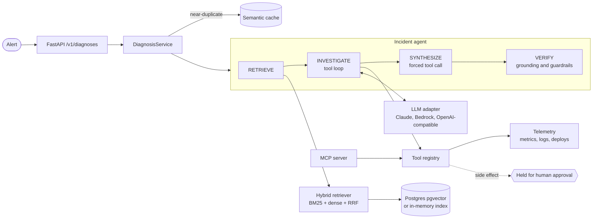

# RootCite

[](https://github.com/sushantm47/rootcite/actions/workflows/ci.yml)
[](pyproject.toml)
[](LICENSE)

RootCite performs evidence-cited root-cause analysis for production alerts. Given an alert,
an agent retrieves the relevant runbooks and past postmortems, investigates live signals
(recent deploys, metrics, logs) through tool calls, and returns a diagnosis in which every
claim cites its evidence. A deterministic verifier checks those citations, guardrails treat
log content as untrusted input, and any action that would change production is held for
human approval.

Much of the time in an incident goes to correlation: linking an alarm to a deploy, a metric,
and the right runbook. RootCite performs that correlation in seconds and shows its work.

**Live demo:** [rootcite.onrender.com](https://rootcite.onrender.com) (the first request after a quiet period takes about a minute while the service starts)

*RootCite was previously named OpsPilot.*

## Features

| Area | Implementation |
|---|---|
| Agent | Explicit state machine `RETRIEVE → INVESTIGATE → SYNTHESIZE → VERIFY` with hard budgets on steps, tool calls, and tokens |
| Retrieval | Hybrid search: BM25 and dense vectors fused with Reciprocal Rank Fusion, contextual chunk headers, optional cross-encoder reranker |
| Storage | PostgreSQL 16 with pgvector (HNSW) and full-text search (GIN) in one database; in-memory index for development and the demo |
| Models | Claude through the Anthropic API or Amazon Bedrock, or any OpenAI-compatible API; structured output through forced tool calls |
| Grounding | Every claim cites evidence IDs; a verifier drops citations that don't exist and caps confidence when evidence is missing or uncorroborated |
| Guardrails | Indirect prompt-injection detection, isolation of tool output, secret and PII redaction, human approval for side-effect tools (OWASP LLM01, LLM02, LLM06) |
| Integrations | Model Context Protocol (MCP) server exposing the tools to MCP clients |
| Resilience | Exponential backoff with full jitter, circuit breaker, semantic cache scoped per service, per-client rate limiting |
| Observability | Structured JSON logs with request IDs; CloudWatch Embedded Metric Format for latency, tokens, grounding, and escalations |
| Evaluation | Golden alert set measuring hit@k and MRR per retrieval mode, root-cause accuracy, grounding rate, tool recall, injection detection, latency, and cost; enforced in CI |
| Delivery | GitHub Actions for CI and demo deployment; Docker; AWS CDK stack for ECS Fargate, ALB, RDS, Secrets Manager, and CloudWatch alarms |

## Architecture



The codebase follows a hexagonal (ports and adapters) architecture. The `domain`,
`retrieval`, `agent`, and `services` packages depend only on the interfaces in `ports`.
Vendor integrations live in `adapters` and are selected in a single composition root,
`container.py`. As a result, the full system, including end-to-end tests, runs without
network access, and moving between environments is a configuration change.

See [docs/DESIGN.md](docs/DESIGN.md) for requirements, trade-offs, and the threat model.

## Getting started

Requires Python 3.11 or later.

```bash
python -m venv .venv
source .venv/bin/activate          # Windows: .venv\Scripts\activate
pip install -e ".[dev]"

rootcite diagnose --service checkout-api --title "p99 latency above 2s and 5xx errors rising"
make run                           # demo UI at http://localhost:8000, API docs at /docs
```

Without model credentials, RootCite uses a deterministic offline planner, which keeps local
development and CI reproducible and free. To use a model:

```bash
export ROOTCITE_LLM_API_KEY=<key>                        # OpenAI-compatible API (Groq by default)
export ROOTCITE_LLM_PROVIDER=anthropic ANTHROPIC_API_KEY=<key>   # Anthropic API
export ROOTCITE_LLM_PROVIDER=bedrock ROOTCITE_MODEL=<model-id>   # Amazon Bedrock
```

To run with PostgreSQL and pgvector:

```bash
docker compose up --build
```

## Configuration

| Variable | Default | Description |
|---|---|---|
| `ROOTCITE_STAGE` | `local` | `local`, `beta`, `gamma`, or `prod`. Gamma and prod require a model provider and PostgreSQL. |
| `ROOTCITE_LLM_PROVIDER` | `offline` | `offline`, `anthropic`, `bedrock`, or `openai`. Set to `openai` automatically when an API key is present. |
| `ROOTCITE_LLM_API_KEY` | | Key for the OpenAI-compatible provider. |
| `ROOTCITE_LLM_BASE_URL` | Groq | Base URL of the OpenAI-compatible API. |
| `ROOTCITE_MODEL` | provider default | Model name or Bedrock model ID. |
| `ROOTCITE_INDEX` | `memory` | `memory` or `postgres` (requires `DATABASE_URL`). |
| `ROOTCITE_EMBEDDER` | `hashing` | `hashing` or `sentence-transformers`. |
| `ROOTCITE_PUBLIC_DEMO` | `false` | Enables per-client rate limiting and disables write endpoints. |
| `ROOTCITE_RATE_LIMIT_PER_MINUTE` | `0`, or `10` in demo mode | Diagnoses per client per minute. |
| `ROOTCITE_DAILY_RUN_LIMIT` | `0`, or `100` in demo mode | Live agent runs per UTC day; cached answers don't count. |
| `ROOTCITE_ALLOWED_ORIGINS` | | Comma-separated browser origins allowed to call the API (CORS). |

The full list is in [.env.example](.env.example).

## API

| Method | Path | Description |
|---|---|---|
| `POST` | `/v1/diagnoses` | Diagnose an alert |
| `POST` | `/v1/ingest` | Re-index the knowledge base (disabled in demo mode) |
| `GET` | `/v1/scenarios` | Sample incidents used by the demo UI |
| `GET` | `/health` | Service status, index size, and model |
| `GET` | `/` | Demo UI |

```bash
curl -s localhost:8000/v1/diagnoses -H 'content-type: application/json' -d '{
  "alert_id": "demo-1",
  "service": "checkout-api",
  "title": "p99 latency above 2s and 5xx errors rising"
}'
```

```json
{
  "root_cause": "Symptoms match 'Database connection pool exhaustion' ... Recent deploy v2.14.0 is a likely trigger.",
  "confidence": 0.55,
  "citations": ["E2", "E1", "E6", "E7"],
  "needs_human": true,
  "grounded": true,
  "warnings": ["possible prompt injection in search_logs output; review manually"],
  "tools_called": ["list_recent_deploys", "search_logs"]
}
```

The sample `checkout-api` logs contain a planted prompt-injection attempt, which the
guardrails flag.

## Evaluation

Retrieval quality on the golden alert set (11 alerts, sample corpus, hashing embedder):

| Mode | hit@5 | MRR |
|---|---|---|
| Keyword (BM25) | 0.909 | 0.909 |
| Dense | 1.000 | 0.909 |
| **Hybrid (RRF)** | **1.000** | **1.000** |

CI fails if hybrid hit@5 falls below 0.9. The agent evaluation (`rootcite eval agent`)
measures root-cause accuracy, grounding rate, tool recall, injection detection, latency, and
estimated cost; run it with a model provider configured for representative numbers.

## Quality

Every push runs ruff, mypy, the pytest suite with coverage, the retrieval quality gate, and
the offline agent evaluation. The suite covers retrieval, chunking, the agent state machine
with scripted model responses, guardrails, the verifier, resilience, configuration, the
OpenAI-compatible adapter (including a full agent run through it), and the HTTP API.

```bash
make lint typecheck test eval
```

## Deployment

**Demo.** The public demo runs on Render's free plan, defined in `render.yaml`. The
`Deploy demo` workflow deploys it after CI passes on `main`. See [docs/DEMO.md](docs/DEMO.md).

**AWS.** `infra/` contains an AWS CDK stack: ECS Fargate behind an Application Load
Balancer, RDS PostgreSQL 16, Secrets Manager, Bedrock access through IAM, auto scaling, a
deployment circuit breaker, and CloudWatch alarms on p99 latency and 5xx rates.

```bash
cd infra
pip install -r requirements.txt
cdk deploy -c stage=beta -c bedrock_model_id=<bedrock-model-id>
```

## Project structure

```
src/rootcite/
  domain/          models and errors
  ports/           interfaces: Embedder, SearchIndex, LLMClient, TelemetrySource
  retrieval/       chunking, BM25, hybrid retrieval
  agent/           state machine, tools, guardrails, verifier, prompts
  resilience/      retries, circuit breaker, semantic cache, rate limiting
  observability/   structured logging, EMF metrics
  services/        diagnosis and ingestion use cases
  adapters/        Claude, Bedrock, OpenAI-compatible, pgvector, embeddings, telemetry
  api/             FastAPI application, schemas, demo UI
  evals/           evaluation harness
  container.py     composition root
  mcp_server.py    MCP server
data/              sample knowledge base and telemetry
evals/             golden alert set
infra/             AWS CDK stack
render.yaml        Render blueprint for the public demo
docs/              design document, runbook, demo guide
tests/             unit and integration tests
```

## Documentation

- [Design document](docs/DESIGN.md): requirements, SLOs, architecture, trade-offs, threat model, cost model
- [Operational runbook](docs/RUNBOOK.md): alarms and responses
- [Demo](docs/DEMO.md): the public demo, its safeguards, and its deployment
- [Changelog](CHANGELOG.md)

## License

[MIT](LICENSE)
